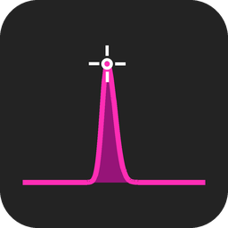

# Spikeless



Radio-HPLC chromatograms exported by **GINA X**: remove the single-point spikes of the
radio-detector, integrate the peaks, make publication-ready figures and a report.
MIT-licensed (see `LICENSE`).

## Install (Windows)

No admin rights, no PATH or registry changes, nothing written into your user profile.

1. On the GitHub page: **Code ▸ Download ZIP**.
2. **Right-click the ZIP ▸ Properties ▸ tick *Unblock* ▸ OK** — without it, SmartScreen stops
   the launcher with *"Windows protected your PC"*.
3. Extract it where it can stay (`C:\Users\Public\Spikeless` serves every account).
4. Double-click **`Spikeless.bat`**. The first time it downloads
   [`uv`](https://github.com/astral-sh/uv), Python and the libraries (about 450 MB, a minute or
   two) into the shared folder `C:\ProgramData\PyApps`, which other tools installed this way
   reuse, and puts a **Spikeless** shortcut on the Desktop. Use the shortcut from then on; to pin
   it, right-click its taskbar button while it runs ▸ *Pin to taskbar*.

Self-contained instead: run **`Spikeless.bat private`** the first time, and everything goes into
`C:\Users\Public\Spikeless` (`SPIKELESS_RUNTIME` picks another place). **`uninstall.bat`**
removes it: the whole private folder, or only Spikeless's part of the shared one.

## Use

One screen: the chromatogram, its results under it, four steps on the right.

1. **Drop** a GINA `.txt` on the window (or **Open…**, or **Ctrl+V** columns copied from Excel
   or Prism). Its **spikes** are excluded at once — red on the plot, listed in **Spikes**,
   where one can be put back.
2. **Background**: the detector's background, shown dashed — nothing to do.
3. **Regions**: **Find regions**, or **Draw region** and drag across a peak on the plot; drag
   an edge to adjust it. The table under the plot gives each region's **net counts ± σ** and
   **% of total** (the radiochemical purity).
4. **Report** — pick the sections, see it, save it as PDF, Word-compatible `.odt`, Excel,
   Markdown or web page. **Figure…** sets what **Copy / Export** make, at its size in mm.
5. **Save…** (Ctrl+S) keeps the whole analysis in a `.json` file.

On the plot: click for a reading line (← → move it), drag to zoom, right-drag to pan,
double-click for the whole run.

**⚙ Options**: the mouse on the plot, what the Runs panel and the results table show, what a
new run starts with (spike rule, background, how regions are found), export resolution, the
isotopes (and which are decay-corrected), region names and conditions per HPLC method. Ctrl+Z / Ctrl+Y undo and redo every change.

Every panel and setting, how the numbers are made, and how to report spike removal in a
publication: **[the user guide](GUIDE.md)**.

## Dev

```
uv run python -m spikeless              # launch
uv run python -m spikeless.<module>     # self-check of spikes, peaks, adjust, io_gina,
                                        #   io_paste, plotting, options, session
uv run python misc/smoke_test.py        # headless run of the whole UI
uv run python misc/paste_test.py        # clipboard import through the UI
uv run python misc/bump.py              # stamp today's date as the version (CalVer)
uv run python misc/make_icon.py         # redraw the icon (needs Pillow)
bash misc/root_test.sh                  # where the launcher decides to install
```

Layers: `io_gina.py`, `io_paste.py` readers · `run.py` the model (a run, its spikes,
background, regions) · `spikes.py`, `peaks.py`, `adjust.py` the maths (no Qt) · `session.py`
the session file · `plotting.py` the chromatogram as a matplotlib figure · `canvas.py` it on
screen, with the mouse · `figure.py`, `report.py`, `options.py` their windows (`plotview.py`
the figure preview), `editors.py` the run names and region details · `widgets.py` the small
widgets they share · `app.py` the main window.
scipy is imported inside the functions that need it, to keep it off the startup path.
